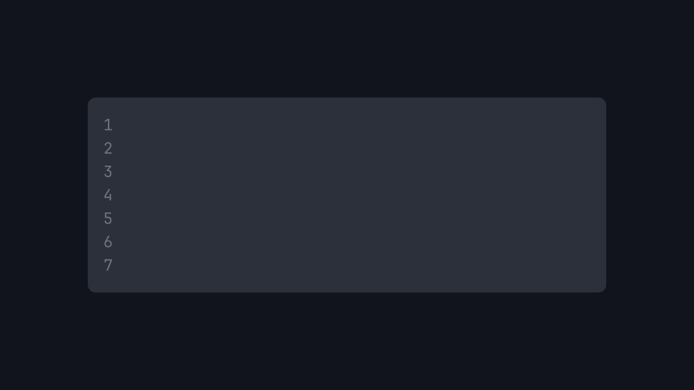
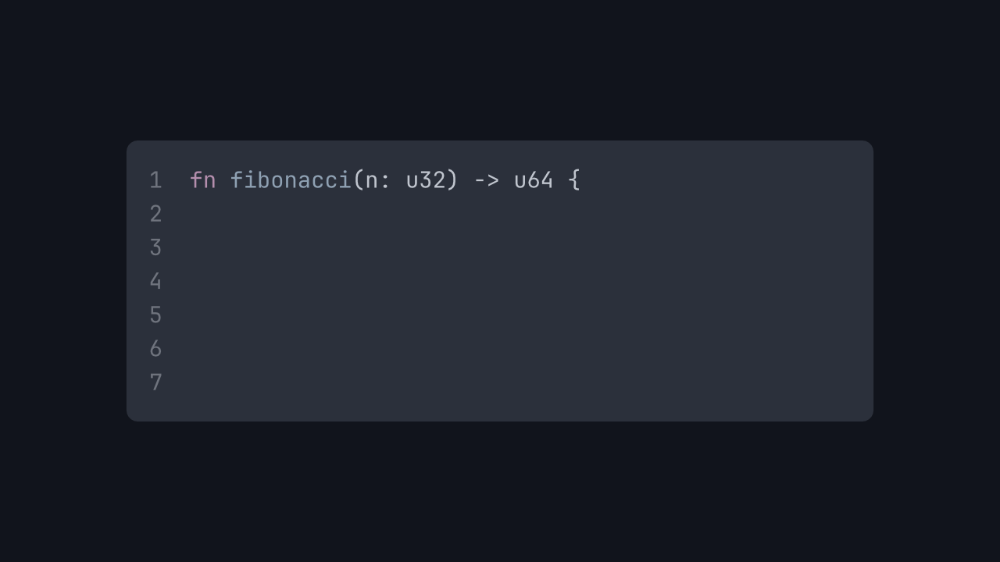
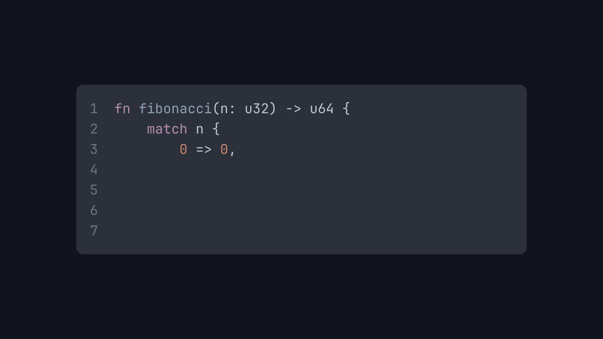
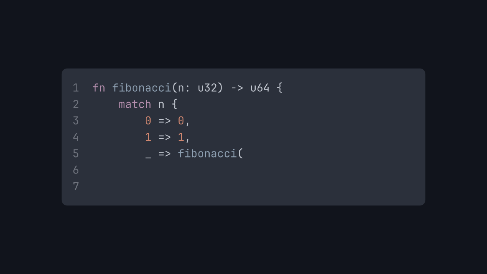
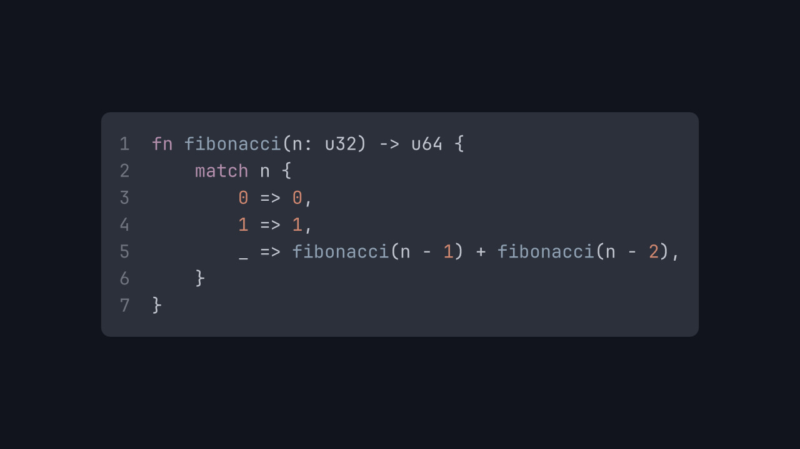
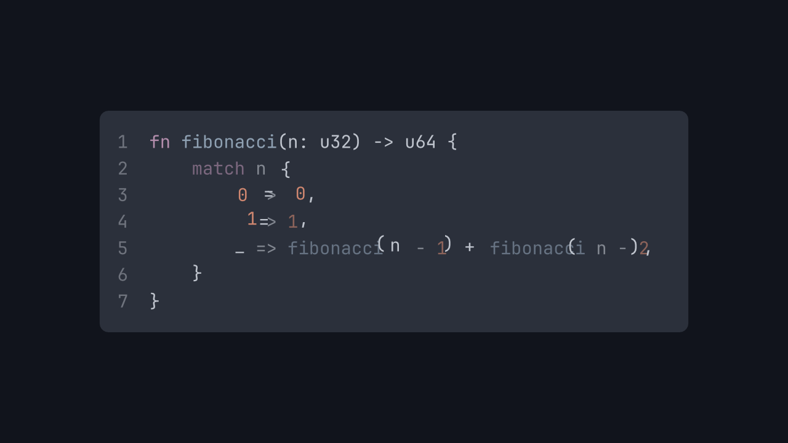
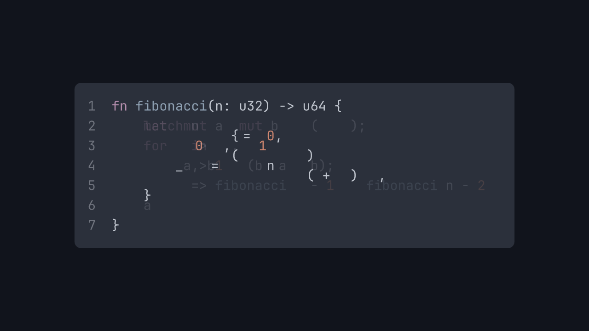
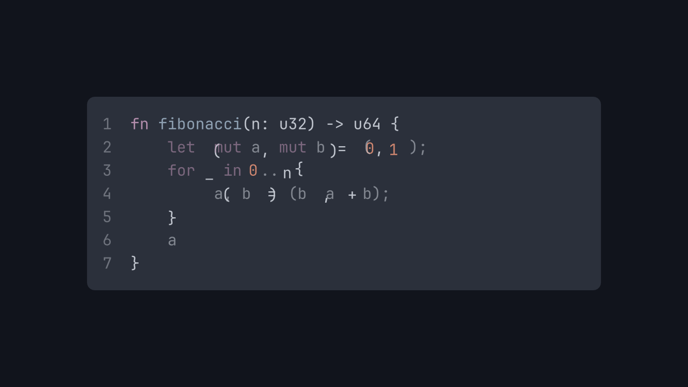
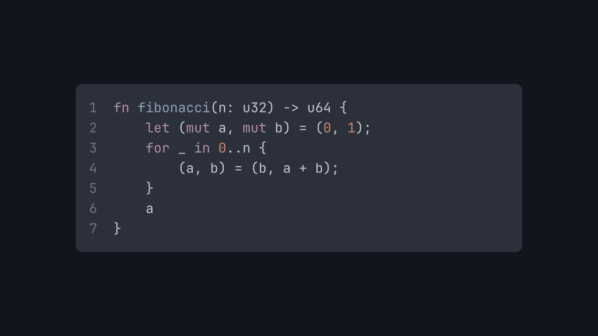

# Code Snippets

Animated, syntax-highlighted code for AniMathIO 2. ABI **1.1.0**, tested with the
released **AniMathIO 2.1.0** Linux CLI. MIT; embedded JetBrains Mono is OFL 1.1.
Plugin ID: `org.animathio.community.code-snippets`.

A behavioral port of [Shiki Magic Move](https://github.com/shikijs/shiki-magic-move/tree/v1.1.0)
by Anthony Fu (**MIT**): retained tokens slide to their new positions while removed
and added tokens fade. Exits fade during 0–60% progress, retained tokens move with smooth ease-in-out
during 15–85%, and entries fade during 40–100%, keeping both edits visible at midpoint.
Upstream 1.1.0 defaults to a 500 ms duration, zero stagger, CSS `ease`, and
leave/move/enter delays of 0.1/0.3/0.7 times the duration; each phase runs for
the full duration, so they overlap. Our normalized windows preserve that overlap
within the host’s 0–1 progress range. We studied its token key synchronization and enter/leave/move
renderer, then implemented bounded token LCS and vector drawing in Rust. No upstream
animation code is copied. See [NOTICE](NOTICE) and its retained MIT license.

## Build and install

```sh
rustup target add wasm32-wasip2
bash community/code-snippets/build.sh
# Output: community/code-snippets/target/code-snippets.amplugin
mkdir -p target/plugins
cp community/code-snippets/target/code-snippets.amplugin target/plugins/
```

Build from the repository root; no AniMathIO checkout is needed. The component and
notices are packaged in the bundle. Set `ANIMATHIO_PLUGIN_DIR` to the absolute
bundle directory when starting AniMathIO. This replaces bundled discovery, so copy
any bundled plugins used by the project there too. Add **Code Snippets** from the
Library, paste code in the inspector and choose language/theme.

For reveal, choose `mode=reveal`, set `progress=0` at the start and `progress=1`
at the end with the inspector's keyframe diamonds. Choose character or line reveal.
For morph, paste the second snippet into `code_to`, choose `mode=morph` and keyframe
`progress` from 0 to 1. Ordinary host linear/eased numeric keyframes control timing;
the plugin never reads a clock. Reverse keyframes work too. Presets that target other
parameter names (for example the Text plugin's `reveal`) do not automatically target
this plugin's `progress`.

## Parameters

| Parameter | Default | Meaning |
| --- | --- | --- |
| `code` | Rust hello snippet | Multiline source; strings hold between host keyframes |
| `code_to` | empty | Multiline target for morph; empty means fade all source tokens out |
| `language` | `rust` | `rust`, `python`, `javascript`, `typescript`, `c`, `cpp` / `c++`, `json`, `latex` / `tex`, `bash` |
| `theme` | `ocean` | Dark `ocean` (base16 Ocean), dark `night` (base16 Eighties), light `paper` (InspiredGitHub) |
| `font_size` | 4 | Percent of the canvas short edge, 0.5–12; JetBrains Mono Regular |
| `line_numbers` | true | Show a fixed-width gutter; morph fades extra line numbers |
| `highlight_lines` | empty | One-based comma-separated lines/ranges, e.g. `2,4-6`; unselected lines use 25% opacity. Empty selects all. Applied independently to each morph endpoint |
| `background` | true | Draw the theme-colored panel |
| `padding` | 4 | Panel padding, percent of short edge, 0–12 |
| `corner_radius` | 2 | Panel corner radius, percent of short edge, 0–12 |
| `mode` | `reveal` | `reveal` or `morph` |
| `reveal_by` | `character` | `character` (Unicode scalar values, including whitespace) or `line` |
| `progress` | 1 | Keyframable number, clamped to 0–1 |

Every parameter uses the ordinary typed schema. Numeric parameters interpolate;
booleans, strings and choices hold. Nonfinite numeric values and malformed highlight
selections return diagnostics. The full code determines highlighting even during
reveal, so partially revealed strings retain their final syntax color. Line numbers
remain visible during reveal. The panel fits the larger of the two morph snippets
and keeps its size/position throughout; long content shrinks to fit 92% of the canvas.
The requested font size is therefore a maximum. Layout remains stable throughout
reveal. Tabs expand to four-column stops and CRLF normalizes to LF.

## Screenshots

Rendered headlessly by the released CLI, with no GUI or audio. Each row shows
`progress=0`, `0.25`, `0.5`, `0.75`, `1`.

| Reveal 0% | Reveal 25% | Reveal 50% | Reveal 75% | Reveal 100% |
| --- | --- | --- | --- | --- |
|  |  |  |  |  |

| Morph 0% | Morph 25% | Morph 50% | Morph 75% | Morph 100% |
| --- | --- | --- | --- | --- |
|  |  |  |  |  |

## Implementation and limits

Syntect uses its pure Rust `fancy-regex` backend, a build-time dump of nine small
original lexical grammars, and its default theme dump. No Oniguruma, C runtime,
JavaScript engine, filesystem, network, random or clock access is used. No host
imports are invoked; capabilities are empty. The vendored WIT is unchanged from the
repository template. The host only exposes DejaVu Sans through `shape-text`, so the
plugin embeds unmodified [JetBrains Mono 2.304](https://github.com/JetBrains/JetBrainsMono/tree/v2.304)
and extracts outlines with `ttf-parser`. Every glyph's contours share one fill,
preserving counters in `O`, `0`, `B`, etc. The font's OFL license is shipped in the
source and bundle.

V1 intentionally provides lexical highlighting, not a semantic language server or
complete language grammar. It recognizes keywords, strings, comments, numbers,
function-like identifiers and punctuation. Python triple strings and C-style block
comments span lines. TypeScript has its own keyword set. Nested Rust block comments,
JS template interpolation, shell heredocs and embedded TeX languages are not parsed.
Layout uses one cell per Unicode scalar (no ligatures, grapheme shaping, bidi or
wide-character cells). Missing font glyphs use a replacement glyph.

Each snippet is capped at 4096 UTF-8 bytes, 1024 Unicode scalar values after tab
expansion, 80 lines and 256 highlighted tokens. The `highlight_lines` string is at
most 512 bytes, with ranges in 1–80. Token LCS uses at most 257² `u16` cells;
subsequent moved-token matching is one-to-one and deterministic. Duplicate
matches resolve in source order. All output is recomputed from parameters; calls
and seek order do not affect it. These bounds protect memory/CPU; the host retains
its independent fuel, memory and epoch backstops. Pathological code can still be
rejected by the sandbox. Full editor integration, semantic parsing, arbitrary fonts,
custom themes, selection rectangles and multi-step transitions are deferred.

## Verification

Verified bundle size: **795,124 bytes (777 KiB)**; the uncompressed component is
2,396,212 bytes. The bundle includes the component, manifest and license notices.

```sh
# Apply the shared machine resource limits to every cargo invocation.
CARGO_BUILD_JOBS=3 CARGO_PROFILE_DEV_DEBUG=0 CARGO_INCREMENTAL=0 nice -n 19 ionice -c3 cargo fmt --manifest-path community/code-snippets/Cargo.toml --check
CARGO_BUILD_JOBS=3 CARGO_PROFILE_DEV_DEBUG=0 CARGO_INCREMENTAL=0 nice -n 19 ionice -c3 cargo clippy --manifest-path community/code-snippets/Cargo.toml --workspace --all-targets --locked -- -D warnings
CARGO_BUILD_JOBS=3 CARGO_PROFILE_DEV_DEBUG=0 CARGO_INCREMENTAL=0 nice -n 19 ionice -c3 cargo test --manifest-path community/code-snippets/Cargo.toml --workspace --locked
python3 community/code-snippets/smoke.py /path/to/animathio-cli target/plugins --screenshots
```

The smoke script creates `.amio` fixtures under `target/smoke`, renders both modes
at 0/25/50/75/100%, checks exact endpoints with equal layout extents, repeatability,
all language choices, both dark themes, the light theme, line selection, no-panel
rendering and a host-sampled typed `progress` keyframe at 0.5 seconds. It checks
panel pixels to reject error placeholders and exercises a 256-token-per-side LCS
and a 1,024-character comment under the default sandbox limits. `--screenshots` refreshes README PNGs;
look at them before committing. CI also builds for `wasm32-wasip2` and runs these
checks against the released 2.1.0 CLI. No desktop window or audio device is opened.
