# Molecule Studio

Turn SMILES into animated 2D molecular structures and reaction diagrams in AniMathIO.
Molecule Studio draws bonds and atom labels, highlights selected parts of a structure,
and can reveal a reaction one stage at a time.

Plugin ID `io.github.animathio.molecule` · ABI 1.1.0 · Tested with AniMathIO 2.3.0

## Build and use

From the plugins repository root, build the bundle with Rust and Python 3.11 or later.

```sh
rustup target add wasm32-wasip2
bash community/molecule/build.sh
mkdir -p target/plugins
cp community/molecule/target/molecule.amplugin target/plugins/
```

Start AniMathIO with `ANIMATHIO_PLUGIN_DIR` set to the absolute bundle directory, then add
**Molecule Studio** from the Library. The override replaces bundled plugin discovery, so include
any other bundles the project uses. A light project background suits the default drawing colors.
For a dark background, change **Bond and text color** to a light color and turn off CPK colors
if you want all labels to use that same ink.

- Choose a preset to load water, benzene, caffeine, aspirin, ethanol, glucose, esterification,
  aspirin synthesis, or ethanol combustion. Named presets supply both SMILES and mode.
- For your own structure, select **Custom** and enter a SMILES string such as `CC(=O)O`.
- For your own reaction, select **Reaction** and fill in both SMILES fields, or enter
  `CC(O)=O.CCO>>CCOC(C)=O.O` in the first field. Separate species on each side with
  dots. Repeat a species to show multiple copies, as the ethanol combustion preset does.
- Keyframe **Progress** from 0 to 1 using the inspector diamonds. Structure mode grows the
  bonds and fades in labels. In reaction mode the reactants draw during 0–42%, dim during
  42–56%, and stay visible while the arrow draws during 56–74%. The products draw during
  74–100%. A clip without keyframes shows the finished diagram.

## Parameters

| Parameter | Default | Effect |
| --- | --- | --- |
| `preset` | `custom` | Supplies named structure or reaction inputs |
| `smiles` | Caffeine | Structure or reactant SMILES. Accepts `reactants>>products` in Custom mode |
| `product_smiles` | Empty | Product side for a custom reaction |
| `mode` | `structure` | `structure` or `reaction` when using Custom |
| `progress` | 1 | Write-on position, clamped to 0–1 |
| `reveal_by` | `bond` | `bond` follows bond order in the input, `atom` follows atom order, and `together` draws all bonds at once |
| `cpk` | On | Color heteroatom labels using the chematic CPK palette |
| `show_carbons` | `bare` | Hide routine skeletal carbon labels or show them with `labeled` |
| `show_hydrogens` | Off | Append hydrogen counts to labels. Hydrogen atoms present in SMILES always draw |
| `show_lone_pairs` | Off | Show dots for supported neutral, nonaromatic heteroatoms |
| `atom_numbers` | Off | Show one-based atom numbers in SMILES order |
| `highlight` | Empty | Mix one-based atoms and zero-based bonds, e.g. `1,4-6,b0,b2-3`. Indices restart in each reaction fragment |
| `bond_order_animation` | `inner-line` | Draw the second stroke inside a ring, or use symmetric strokes with `double-stroke` |
| `stroke_width` | 5 | Bond stroke width, 2–16% of a typical bond length |
| `font_size` | 49 | Atom label size, 30–85% of a typical bond length |
| `arrow_label` | Empty | Short caption above a reaction arrow, up to 128 UTF-8 bytes |
| `accent` | Amber | Reaction arrow and highlights |
| `ink` | Dark slate | Bonds, atom numbers and labels outside the CPK palette |

Isolated five- and six-membered rings expressed with aromatic SMILES use an inner circle.
Fused aromatic systems use alternating orders when chematic can assign them. Tetrahedral
`@` and `@@` markers can produce a solid or hashed wedge with its narrow end at the center.
The explicit water graph uses the measured 104.5° H–O–H angle.
[NIST experimental bond angles](https://cccbdb.nist.gov/expangle2x.asp?all=0&descript=aHOH)

## Released-host screenshots

| Caffeine 0% | 25% | 50% | 75% | 100% |
| --- | --- | --- | --- | --- |
| 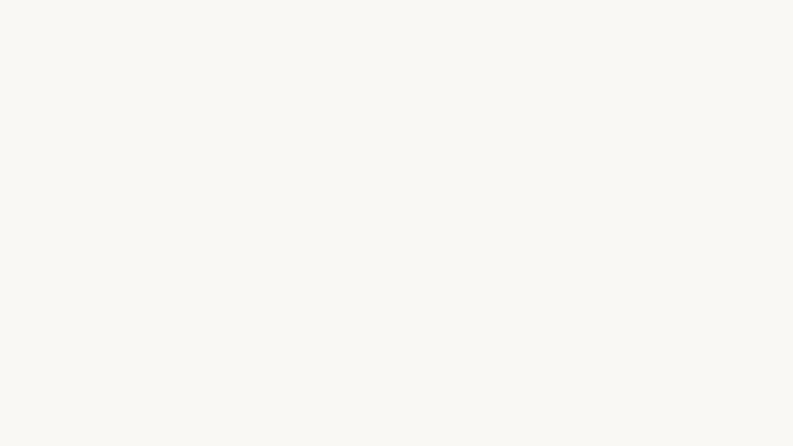 | 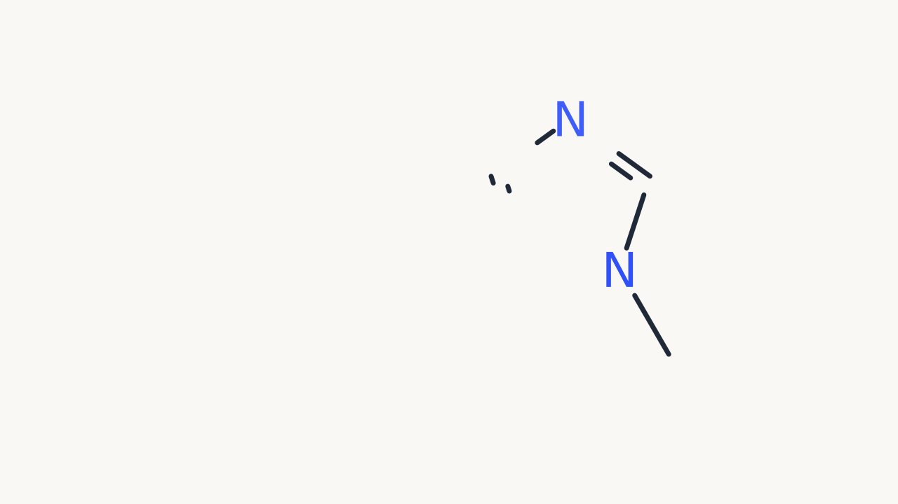 | 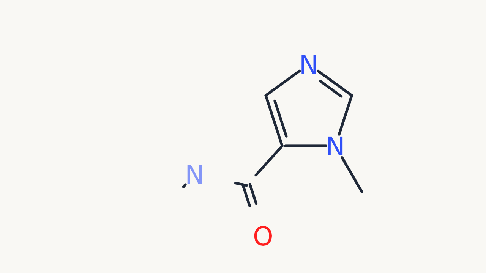 | 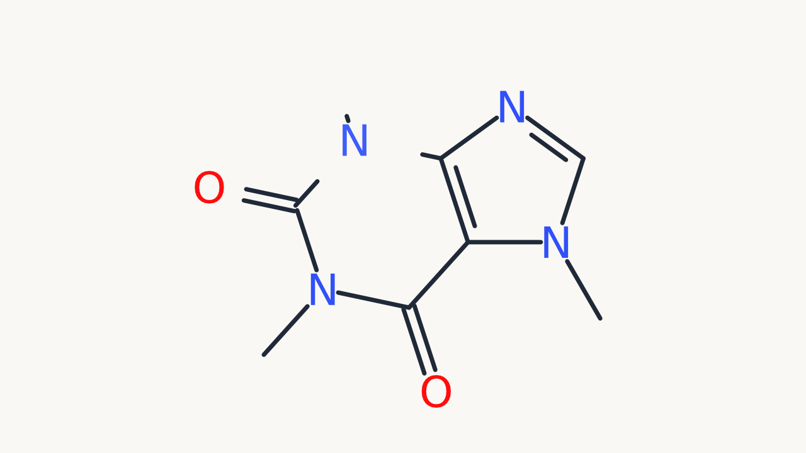 | 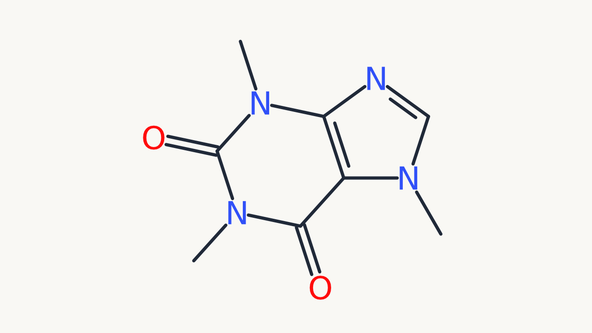 |

| Water with lone pairs | Numbered benzene with highlights | Glucose with stereobonds |
| --- | --- | --- |
| 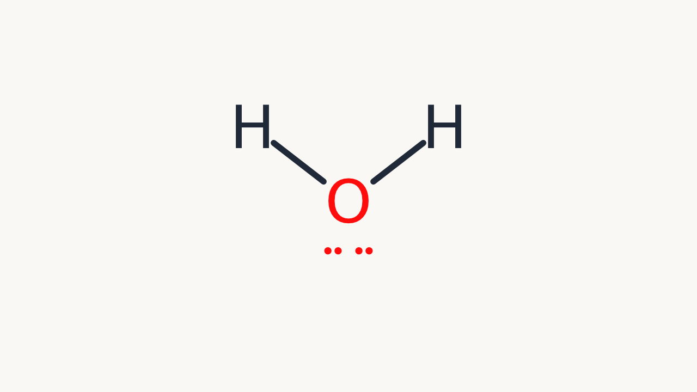 | 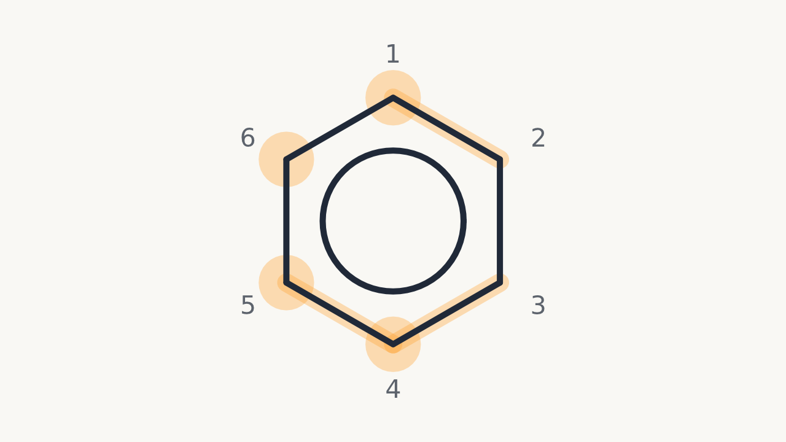 | 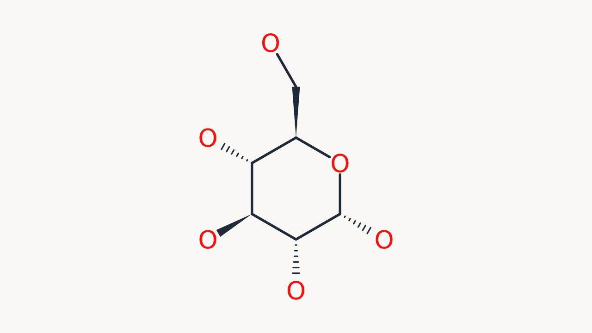 |

| Combustion reactants | Arrow in progress | Finished combustion |
| --- | --- | --- |
| 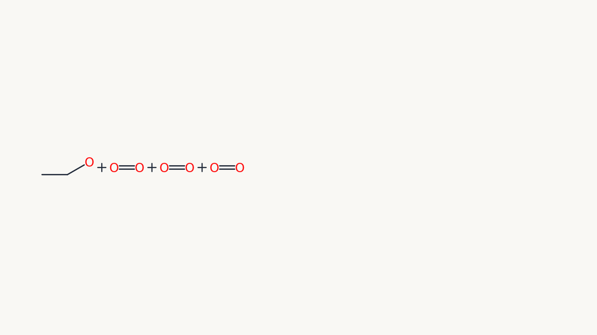 | 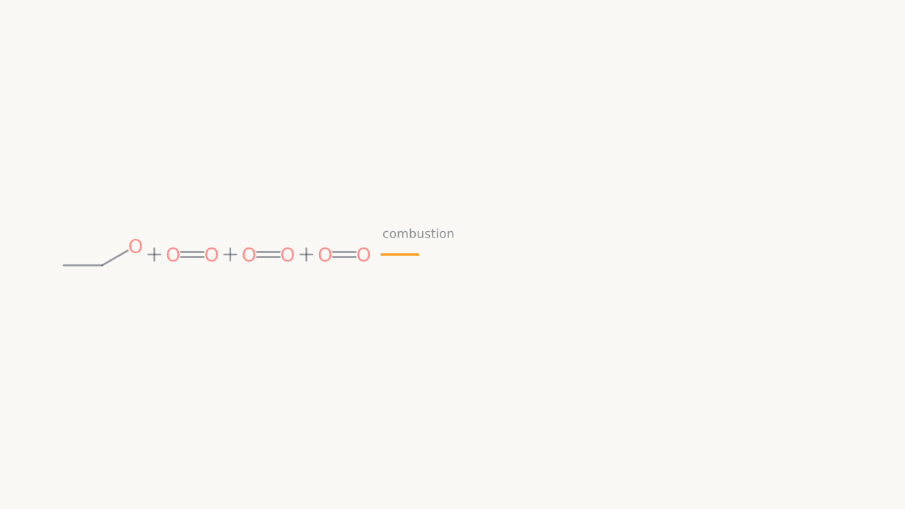 | 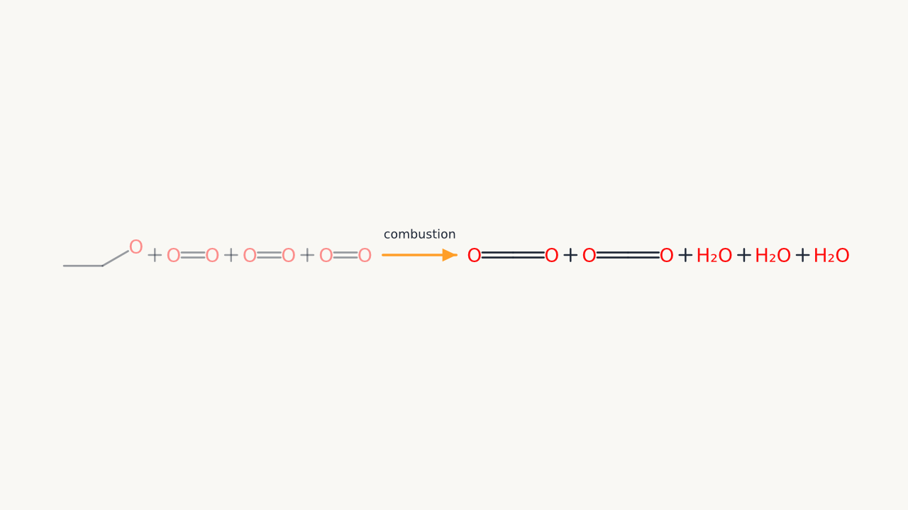 |

[Unannotated water](screenshots/water.png) · [Unannotated benzene](screenshots/benzene.png) ·
[Aspirin synthesis](screenshots/aspirin-synthesis.png)

## Implementation and limits

The WASM component uses chematic 1.2.3 for SMILES parsing, chemistry perception and 2D
layout. It emits vector paths through ABI 1.1.0 and uses the host's `shape-text` import for labels.
The renderer uses only evaluated parameters and canvas dimensions. Per-call layout and glyph
preparation are deterministic, and the component requires no additional capabilities.
Upstream commits and licenses are recorded in [NOTICE](NOTICE).

Inputs are capped at 512 UTF-8 bytes per SMILES field, including the separator when using
one-field reaction syntax. A complete clip supports up to 128 atoms and 256 bonds across both
sides, with at most eight fragments per side. The host's sandbox limits also apply. The layout
produces teaching diagrams. Dense or unusual structures can crowd labels, and the plugin
does not balance reactions, model reaction mechanisms, or infer unspecified stereochemistry.

## Verification

```sh
CARGO_BUILD_JOBS=2 CARGO_PROFILE_DEV_DEBUG=0 CARGO_INCREMENTAL=0 \
  nice -n 19 ionice -c3 cargo test --manifest-path community/molecule/Cargo.toml --locked
python3 community/molecule/smoke.py /path/to/animathio-cli target/plugins --screenshots
```

The smoke script requires Pillow. It verifies repeat renders and a host-sampled progress keyframe
pixel for pixel, compares reveal modes and palettes, checks preset and custom reactions, and
asserts diagnostics on malformed and oversized inputs. It writes fixtures under the plugin's
`target/smoke`.
