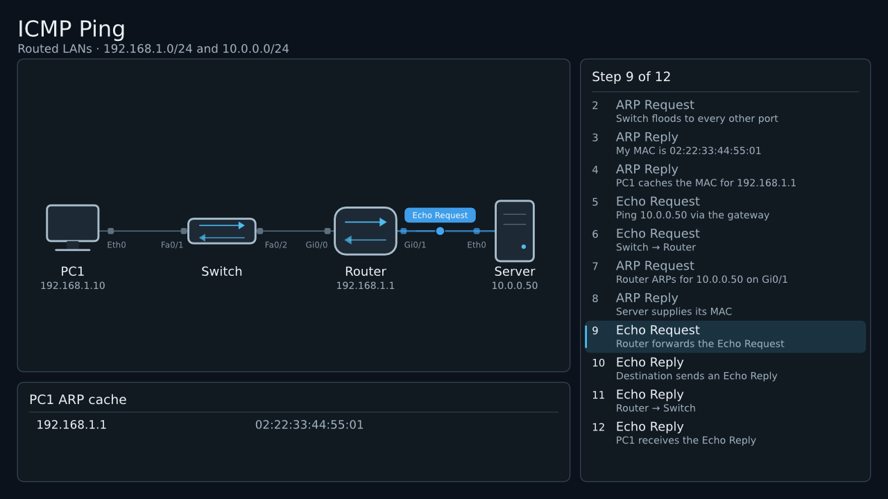
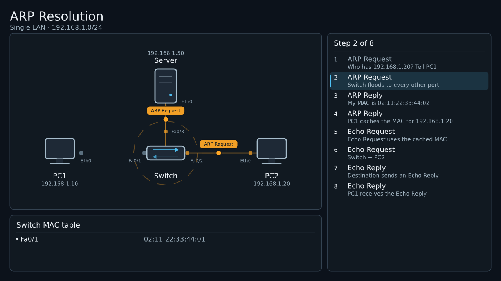
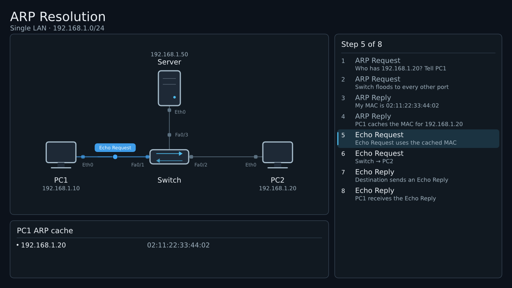
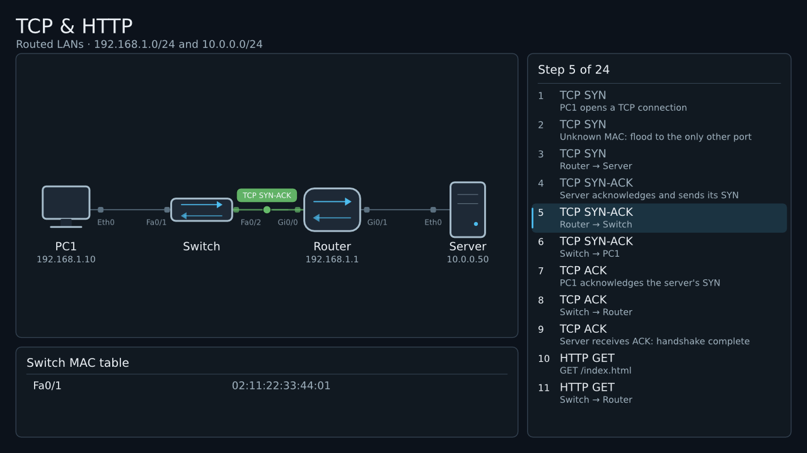
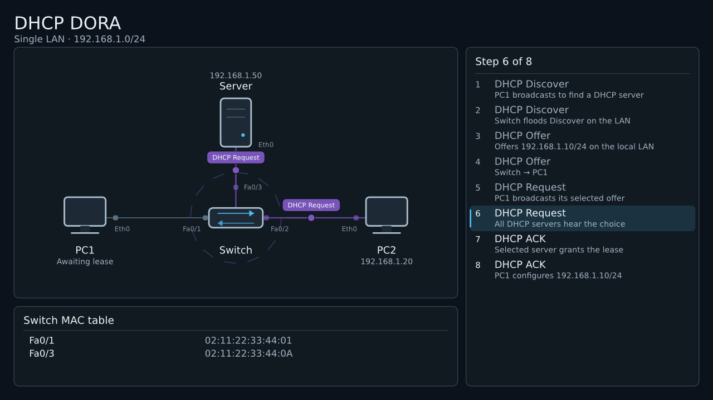
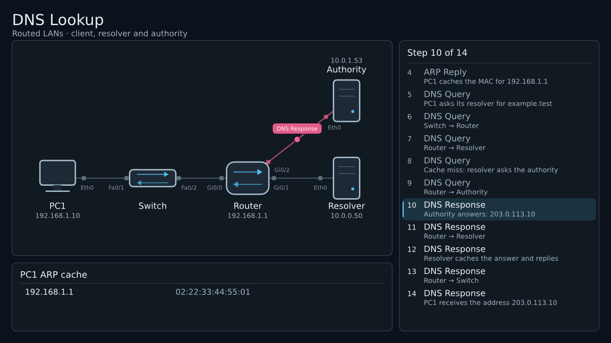
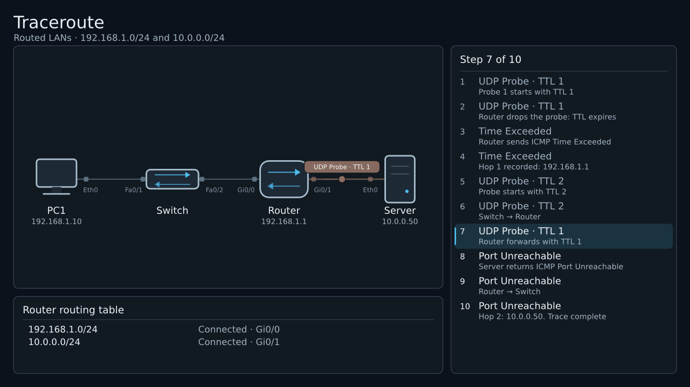

# Net Lab

Net Lab animates six networking lessons as an AniMathIO clip source. Scrub
packet flight, follow the active hop, and watch a switch learn source MAC
addresses or a host fill its ARP cache.

Plugin ID `io.github.animathio.network` · ABI 1.1.0 · MIT

## Build and use

```sh
rustup target add wasm32-wasip2
bash community/network/build.sh
ANIMATHIO_PLUGIN_DIR="$PWD/community/network/target" animathio
```

Run these commands from the plugins repository root. The build produces
`community/network/target/network.amplugin`. When using the plugin directory
override with other plugin clips, include their bundles in that directory too.

Add **Net Lab** from the Library and choose a scenario and topology in the
inspector. Keyframe `progress` from 0 to 1 over the part of the clip where you
want the exchange to play. Use two equal keyframe values to pause on a frame.
Progress at 1 holds on the completed timeline and learned table state.

## Scenarios

| Preset | What plays |
| --- | --- |
| `ping` | Resolve the server or gateway with ARP, send an ICMP Echo Request, and follow the reply. On the routed preset the router resolves the server on its own LAN. |
| `arp` | Flood the request on the LAN, follow the unicast reply, then ping the same peer using the cached MAC. |
| `tcp` | SYN, SYN-ACK and ACK, followed by an HTTP GET, 200 OK and an orderly close. |
| `dhcp` | Broadcast Discover and Request, receive unicast Offer and ACK, and see the client acquire its address. The routed preset uses the gateway's DHCP service on the client LAN. |
| `dns` | Ask the recursive resolver for `example.test`. The resolver knows the authority's address, queries it on a cache miss, and returns the A record. |
| `traceroute` | Follow UDP probes with increasing TTL. A router returns ICMP Time Exceeded and the destination returns ICMP Port Unreachable. |

Each event animates one link hop. A switch flood can send copies along multiple
links simultaneously. ARP and MAC entries appear once the learning hop finishes.
The route panel shows the router's configured connected networks. TCP and
traceroute start with endpoint ARP already resolved, and DNS elides ARP beyond
the initial client-side lookup. The transport lessons show TCP flags and the
order of TCP and UDP messages. Transport port numbers and TCP sequence and
acknowledgment numbers are omitted. The lessons use IPv4 and a single switch with
optional routing. Timing is illustrative, with equal time per hop and brief
holds before and after the exchange.

## Parameters

| Parameter | Default | Meaning |
| --- | --- | --- |
| `scenario` | `ping` | Choose one of the six lessons above. |
| `topology` | `through-router` | `single-switch` for one LAN, `through-router` for separate LANs. DNS adds an authoritative service to the selected preset. |
| `progress` | 1 | Timeline position from 0 to 1. |
| `steps` | 24 | Maximum link hops to play, from 1 to 200. Values past the lesson's last hop play the full lesson. |
| `labels` | `full` | `full` adds port names and explanatory notes. A port name is hidden briefly if a packet leaves too little room beside its link. `brief` abbreviates packet labels. `none` uses dots for packets and hides port and IP labels. |
| `show_tables` | true | Show the state panel. |
| `table` | `auto` | Select `mac`, `arp`, or `route` manually. Auto uses ARP for ping and DNS, routing for traceroute on the routed preset, and MAC for the other lessons. |
| `packet_size` | 2.4 | Packet size, 0.5–6% of the shorter canvas edge. |
| `accent` | `#4FC3F7` | Color for device details and active step emphasis. Packet color distinguishes protocols. |
| `show_step_list` | true | Show the packet timeline and highlight the current hop. |
| `speed_lines` | true | Draw short trails behind moving packets. |

## Screenshots

Rendered with the released AniMathIO 2.3.0 CLI.

| ICMP ping | ARP flood | Learned ARP cache |
| --- | --- | --- |
|  |  |  |

| TCP handshake | DHCP request | DNS answer | Traceroute |
| --- | --- | --- | --- |
|  |  |  |  |

## Tests and implementation

```sh
CARGO_BUILD_JOBS=2 CARGO_PROFILE_DEV_DEBUG=0 CARGO_INCREMENTAL=0 \
  nice -n 19 ionice -c3 cargo test --manifest-path community/network/Cargo.toml --locked
python3 -m pip install Pillow
python3 community/network/smoke.py /path/to/animathio-cli community/network/target --screenshots
```

The smoke script renders both topology presets at five progress values per
scenario, with tables visible and hidden. It verifies exact PNG repeatability,
host-sampled progress keyframes, diagnostics and parameter changes. The native
tests cover hop order, switch flooding, table replay, the DHCP lease boundary,
and probe TTL before and after routing.

Every frame reconstructs the event list and table prefix from its parameters.
The longest lesson contains 24 hops and the largest topology has five devices.
The plugin draws original vector glyphs and uses the host's text drawing
primitive. Rendering uses no host imports or capabilities and is independent
of wall clock and seek order.

The MIT netsim projects informed the protocol sequencing. Their credits and
licenses are in [NOTICE](NOTICE). Protocol references include
[RFC 826](https://www.rfc-editor.org/rfc/rfc826.html),
[RFC 792](https://www.rfc-editor.org/rfc/rfc792.html),
[RFC 1812](https://www.rfc-editor.org/rfc/rfc1812.html),
[RFC 9293](https://www.rfc-editor.org/rfc/rfc9293.html),
[RFC 2131](https://www.rfc-editor.org/rfc/rfc2131.html) and
[RFC 1034](https://www.rfc-editor.org/rfc/rfc1034.html).
