# Ray Optics

Animated optics diagrams for AniMathIO 2. Plugin ID `io.github.animathio.optics`,
ABI **1.1.0**, verified with the released AniMathIO **2.3.0** Linux CLI.

## Build and use

```sh
rustup target add wasm32-wasip2
bash community/optics/build.sh
export ANIMATHIO_PLUGIN_DIR="$PWD/community/optics/target"
```

Run from the plugins repository root. The build produces
`community/optics/target/optics.amplugin`. To test a local build, start AniMathIO
with the directory above, add **Ray Optics** from the Library, and choose a
setup in the inspector. The plugin draws on a transparent canvas. The default
palette is designed for a dark project background.

Keyframe `progress` from 0 at the start to 1 at the end to draw the rays in
order of propagation. On `tir`, the same curve also sweeps the incidence
angle from 0° to `angle_deg`. At the critical angle the transmitted ray grazes
the interface. Above it, only the reflected ray remains. Other numeric
parameters, such as lens distance or refractive index, can be keyframed
independently.

## Setups

| Setup | What it shows |
| --- | --- |
| `lens-diagram` | Parallel, optical-centre and focal rays for a converging or diverging thin lens, with F/2F markers and the object and image arrows. |
| `mirror` | Parallel, vertex and focal rays for a concave or convex mirror, with its focal point F and centre of curvature C. |
| `refraction` | Transmission through a parallel slab, incidence and transmission angles measured from the normal, and Snell's equation. The exit ray is parallel to the incident ray when both faces transmit. |
| `tir` | An angle sweep from the lower medium into the upper medium, with the critical angle marked when one exists. Media follow the same convention as `refraction`: n₁ is the medium the ray starts in (the slab, labelled below the interface) and n₂ the one it would transmit into, with `sin θc = n₂/n₁` shown above the interface, clear of the ray sweep. The reflected branch below that threshold uses schematic brightness. |
| `dispersion` | An incident white beam in air and wavelength-dependent refraction through an equilateral prism. Shorter wavelengths have higher indices and, in the default setup, bend farther toward the base. |

Real images are where solid outgoing rays converge. Virtual images use dashed
back-projections and a dashed image arrow. The lens bends rays at its optical
plane, and the spherical mirror uses its vertex plane and the paraxial relation
`f = R/2`. A ray that would miss the on-screen aperture is omitted. With the
object at the focus, the outgoing rays are parallel and the label shows
**Image at infinity**. Strongly magnified conjugates — a concave mirror or
converging lens with the object between F and 2F, or inside F — shrink the
whole construction (focal length, distances and heights together) until the
image arrow and all three rays fit, so the magnified image always stays on the
diagram. For the geometric conventions, see OpenStax on [thin lenses](https://openstax.org/books/university-physics-volume-3/pages/2-4-thin-lenses)
and [spherical mirrors](https://openstax.org/books/university-physics-volume-3/pages/2-2-spherical-mirrors).

## Parameters

| Parameter | Default | Meaning |
| --- | --- | --- |
| `setup` | `lens-diagram` | One of the five setups above. |
| `progress` | 1 | Ray reveal from 0 to 1. Also sweeps incidence in `tir`. |
| `lens_type` | `converging` | `converging` or `diverging`, which selects the sign of the focal length. |
| `focal_length` | 20 | Lens focal length magnitude, 5–50% of the canvas short edge. |
| `object_distance` | 35 | Positive distance from the optic, 5–90% of the short edge. The value is limited to the visible diagram on narrow canvases. |
| `object_height` | 15 | Object arrow height, 2–30% of the short edge. |
| `curvature` | 30 | Signed mirror radius, −50 to 50% of the short edge. Negative is convex. Zero and positive values are concave. Magnitudes below 10 use a radius of 10%. |
| `index_1` | 1.0 | Surrounding medium index, 1.0–2.5. Light enters from this medium in `refraction` and from `index` in `tir`. |
| `index` | 1.5 | Slab, lower medium, or prism index, 1.0–2.5. In `dispersion` this is the index at 550 nm. |
| `angle_deg` | 45 | Incidence from the normal, 0–89°. In `tir` it sets the sweep's endpoint. |
| `ray_count` | 12 | 1–64 spectral samples. One sample uses 550 nm. |
| `show_normal` | true | Draw the dashed surface normal in `refraction` and `tir`. |
| `show_labels` | true | Show diagram, image and angle labels. |
| `show_focal` | true | Draw lens or mirror focal markers. |
| `spectrum` | true | Trace colored wavelengths. Switch off for one 550 nm ray in the accent color. |
| `accent` | `#FFCD42FF` | Color and opacity of the main rays. |

The prism uses a two-term Cauchy curve calibrated at 550 nm whose coefficient
`B = 0.008 µm² · (n − 1)` scales with n − 1: about 0.004 µm² at n = 1.5
(BK7-like), proportionally weaker for lower indices, and exactly zero at an
index of 1, which is why vacuum disperses nothing. The spectrum
uses approximate display colors sampled from 400 to 700 nm. A ray that strikes
a prism corner ends there because the corner has no unique surface normal.
The tracer caps interactions at 8 per ray and budgets 256 segments across a
frame. Glass and prism paths follow the transmitted ray whenever one exists and
continue along the reflected ray during total internal reflection.

## Screenshots

Rendered at 1280×720 using AniMathIO 2.3.0. The [screenshots directory](screenshots)
also contains 0%, 25%, 50% and 75% frames for each setup.

| Converging lens | Diverging lens | Converging lens with object inside focus |
| --- | --- | --- |
| 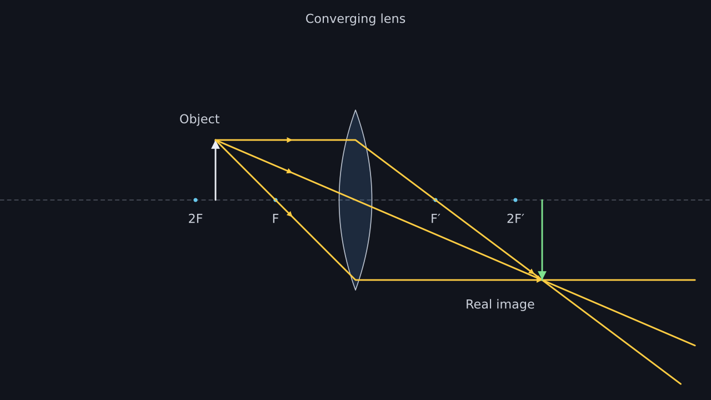 | 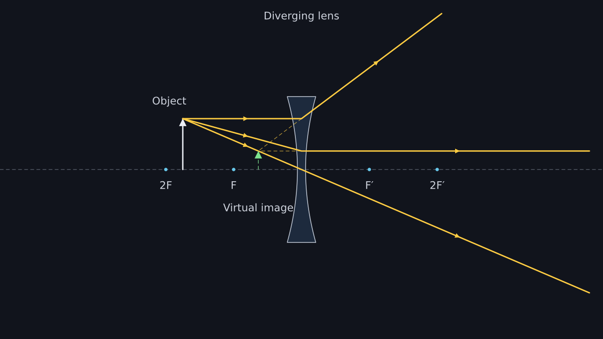 | 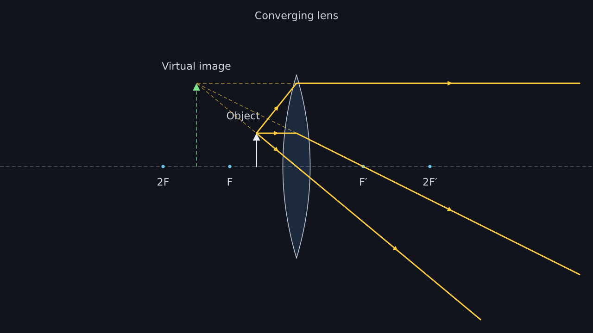 |

| Concave mirror | Convex mirror | Concave mirror with object inside focus |
| --- | --- | --- |
| 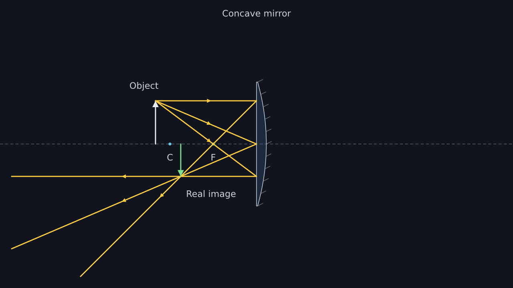 | 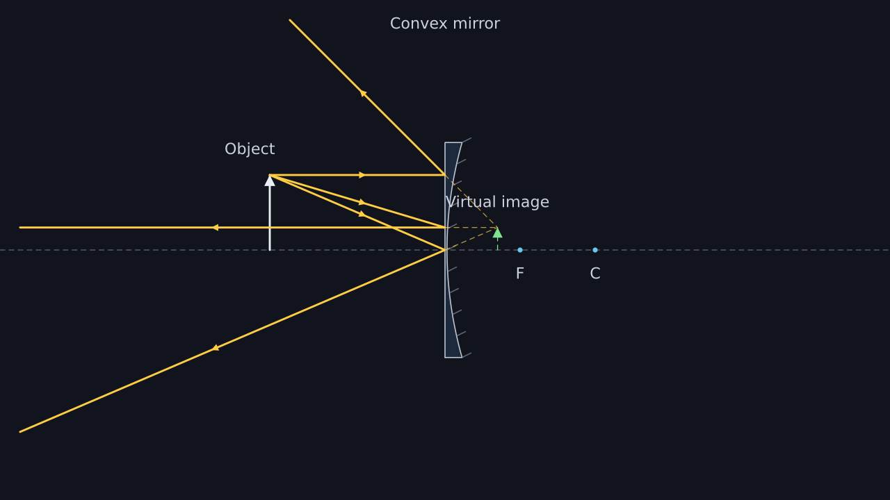 | 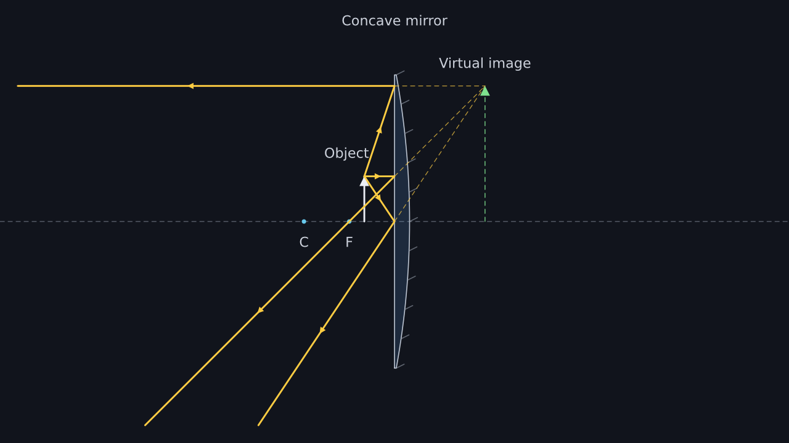 |

| Refraction | Below the critical angle | Above the critical angle | Prism dispersion |
| --- | --- | --- | --- |
| 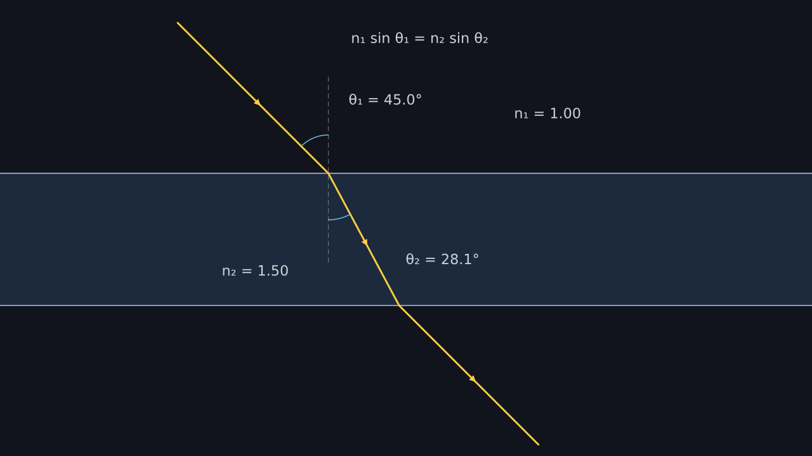 | 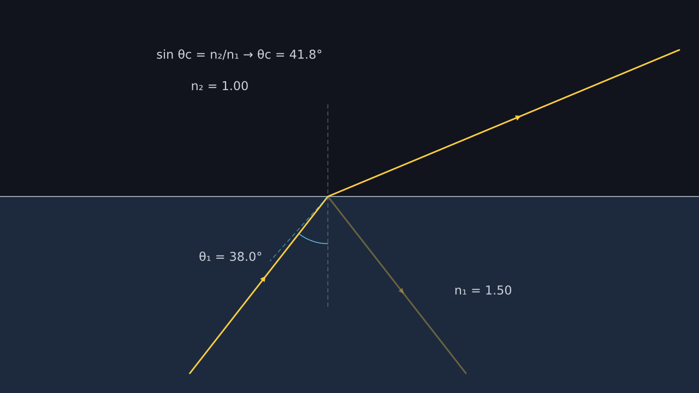 | 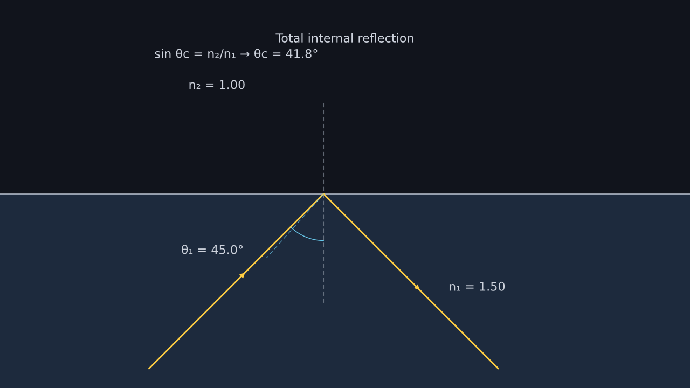 | 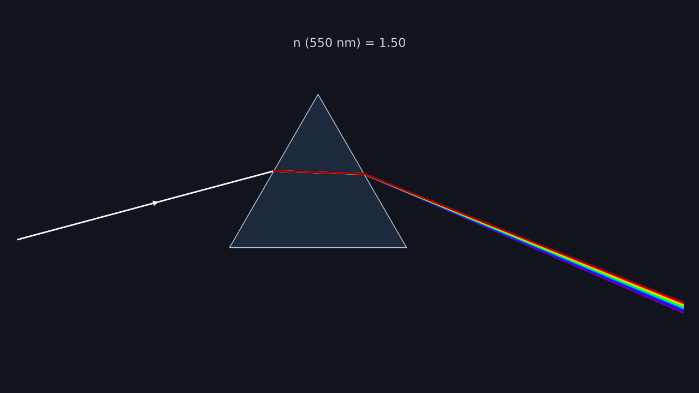 |

Magnified conjugates shrink to fit instead of leaving the diagram:

| Lens, object between F and 2F | Mirror, object between C and F | Mirror, object inside F |
| --- | --- | --- |
| 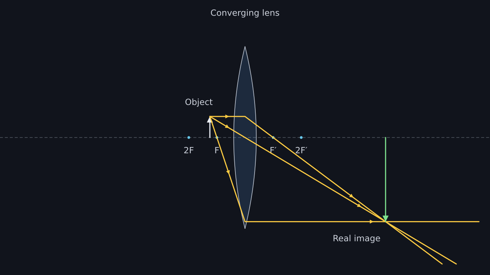 | 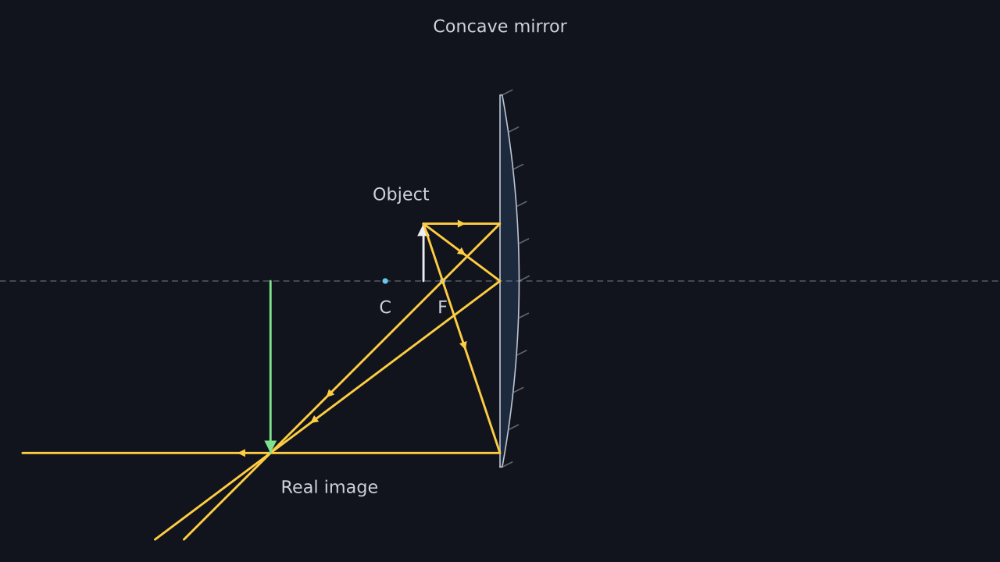 |  |

## Verification and credits

```sh
CARGO_BUILD_JOBS=2 CARGO_PROFILE_DEV_DEBUG=0 CARGO_INCREMENTAL=0 \
  cargo test --manifest-path community/optics/Cargo.toml --locked
python3 community/optics/smoke.py /path/to/animathio-cli community/optics/target --screenshots
```

The smoke script needs Pillow and a released 2.3.0 CLI. It verifies progressive
rendering, repeat PNG bytes for each setup, parameter toggles, magnified mirror
and lens conjugates, a sampled
keyframe, a portrait render, and a 64-ray prism under the host's default
limits. Frames depend only on the evaluated parameters and canvas size.
The component emits vector paths and host-rendered text. It calls no host
imports and uses no filesystem, network, clocks or randomness.

The Rust tracer draws on the behavior of **Ray Optics Simulation** by Rick Tu
and contributors, version 5.5.0, under Apache-2.0. See the [NOTICE](NOTICE) for
the source files studied and the [upstream license](assets/ray-optics-LICENSE)
for its terms. The plugin code is [MIT](../../LICENSE).
