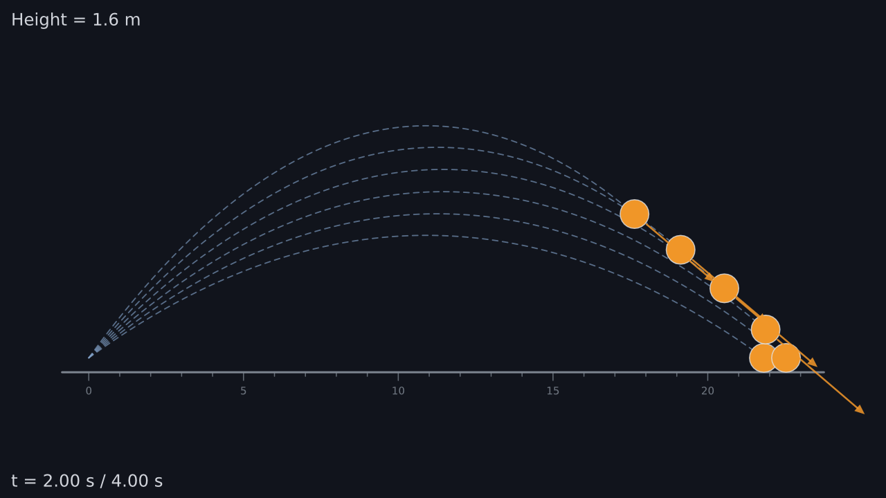
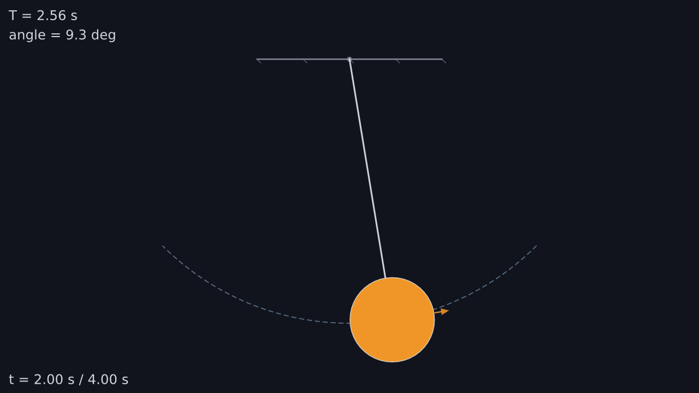
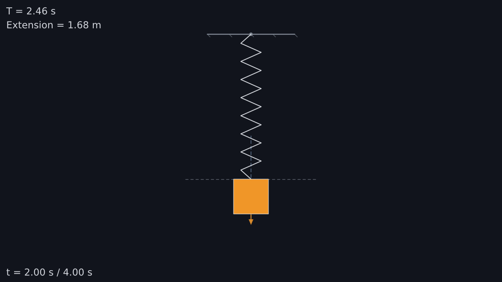
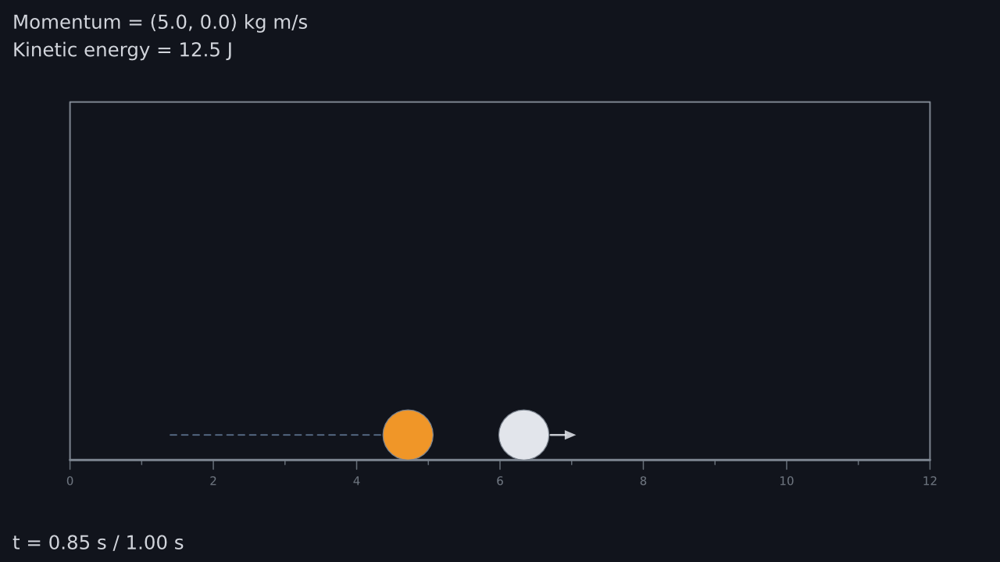
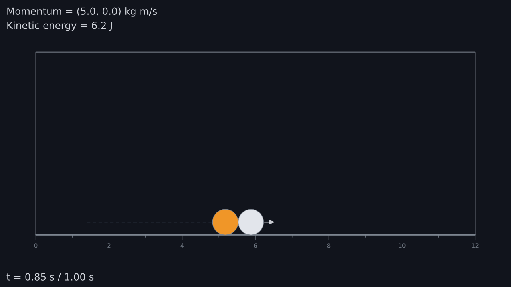
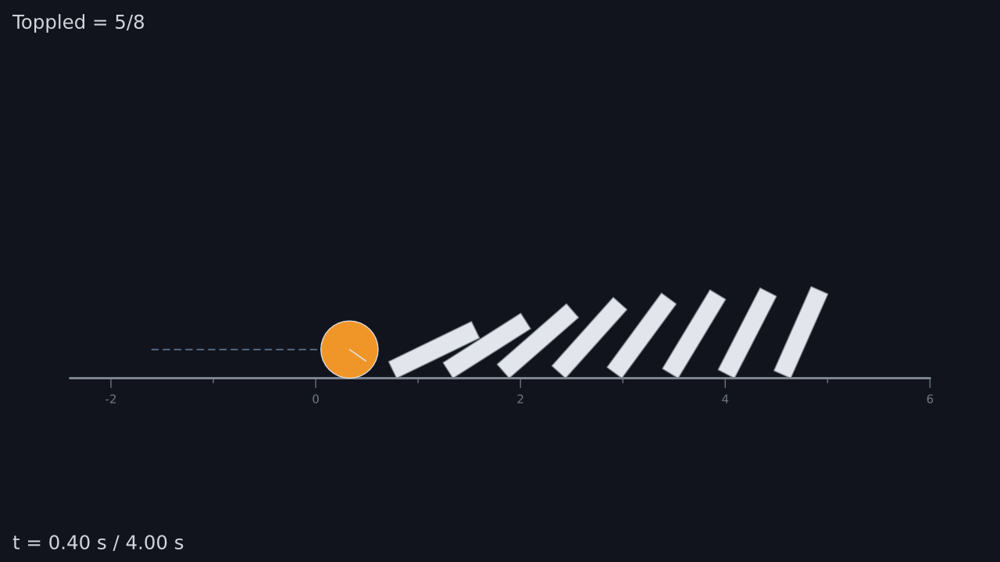

# Physics Play

Physics Play adds five keyframeable mechanics demos to AniMathIO. Draw a family of
projectile trajectories, compare pendulum and spring periods, measure momentum
in elastic and inelastic collisions, or watch a row of dominoes topple.

Plugin ID `io.github.animathio.physics` · ABI 1.1.0 · MIT

| Projectile | Pendulum | Spring |
| --- | --- | --- |
|  |  |  |

| Elastic collision | Fully inelastic collision | Dominoes |
| --- | --- | --- |
|  |  |  |

## Use in AniMathIO

Add **Physics Play** from the Library and choose a **Scene** in the inspector.
Keyframe **Progress** from 0 at the start of the clip to 1 at the end. **Duration**
sets the simulated seconds covered by that interval. Linear keyframes give a
constant simulation rate. Adjust the keyframes to slow down an impact or play
a scene in reverse.

Each frame starts with the parameters sampled at that frame. For example, a
gravity keyframe changes the entire computed trajectory for that frame.

| Scene | Motion and readouts |
| --- | --- |
| `projectile` | A single launch or a fan spanning up to ±9° around the chosen angle. Shows height or landing range for the chosen angle, with trails and arrows for the moving bodies. |
| `pendulum` | A bob released from rest. Shows the current angle and the full-amplitude period from the elliptic-integral formula. |
| `spring` | A vertical Hooke oscillator released from rest at 30% beyond equilibrium. The spring is tuned so its static extension equals **Length**. Shows its period and extension. |
| `collision` | Equal-mass disks in a 12 × 5 m arena. Shows the disks' total momentum and translational kinetic energy. The walls can exchange momentum with the disks. |
| `stack` | A rolling ball tips the first domino in a row. Contacts trigger the remaining dominoes, and the readout counts how many have tipped past 0.6 radians. |

To compare collision types, set **Bodies** to 2, **Speed** to 5 m/s, and
**Gravity** and **Friction** to 0. At 0.85 s the first collision is over and the
walls have yet to act. With 1 kg disks, momentum is 5 kg·m/s in both cases.
**Restitution** 1 transfers the launch velocity to the second disk while
preserving 12.5 J of kinetic energy. **Restitution** 0 leaves both disks moving
at 2.5 m/s with 6.25 J in total.

## Parameters

| ID | Default | Meaning |
| --- | --- | --- |
| `scene` | `projectile` | `projectile`, `pendulum`, `spring`, `collision`, or `stack` |
| `progress` | 1 | 0–1, fraction of the simulated duration |
| `duration_s` | 4 | 0.5–30 simulated seconds |
| `gravity` | 9.81 | 0–30 m/s² downward acceleration |
| `bodies` | 6 | 1–12 projectiles, collision disks or dominoes. Rounded to an integer. |
| `mass` | 1 | 0.1–10 kg per disk for collision momentum and energy. Changing all disk masses together leaves the equal-mass trajectories unchanged. |
| `speed` | 15 | 0–40 m/s initial speed for projectiles, the first disk, or the domino launcher |
| `angle_deg` | 45 | 0–90° launch angle or pendulum release angle |
| `length_m` | 1.5 | 0.2–10 m pendulum length or spring equilibrium extension |
| `restitution` | 0.8 | 0–1 coefficient of restitution for disk contacts and impact transfer in the domino row |
| `friction` | 0.8 | 0–1 tangential friction for disk contacts and rolling resistance in the domino launcher |
| `show_vectors` | true | Show velocity arrows |
| `show_trail` | true | Show motion traces |
| `show_ground` | true | Show the metre scale for projectile, collision and stack |
| `accent` | Amber | Color for the main body and its velocity arrow |

With zero gravity, projectiles travel in straight lines and the pendulum and
spring stay at their release positions. The pendulum and spring are undamped.
The domino scene uses floor pivots and a simplified impulse transfer. The disk
solver models translational contact impulses and friction.

## Build and verify

```sh
rustup target add wasm32-wasip2
bash community/physics/build.sh
# Output: community/physics/target/physics.amplugin
```

Set `ANIMATHIO_PLUGIN_DIR` to the absolute directory containing the bundle.
When using this override, include the other plugins needed by your projects.

```sh
CARGO_BUILD_JOBS=2 CARGO_PROFILE_DEV_DEBUG=0 CARGO_INCREMENTAL=0 nice -n 19 ionice -c3 cargo test --manifest-path community/physics/Cargo.toml --locked
python3 community/physics/smoke.py /path/to/animathio-cli community/physics/target
```

The native tests check analytic motion, collision momentum and energy, domino
propagation, deterministic replay and operation counts. The smoke test uses the
released 2.3.0 CLI and checks every scene at five progress values, including a
host-sampled keyframe and repeated 30-second renders with 12 bodies. It checks
the background and body colors so an error placeholder fails the test. Add
`--screenshots` to regenerate the PNGs in [screenshots](screenshots/).

## Simulation and credits

Projectile and spring positions use closed-form equations. The pendulum uses a
fourth-order Runge–Kutta stepper on at most one quarter period, then applies
symmetry. The disk and domino scenes replay from zero on a fixed grid of up to
3,600 steps. Disk work is bounded by 66 pair checks per step, and traces and ruler
graduations have explicit bounds. With the same parameters and canvas, seek order
and prior calls have no effect. Labels use the host's vector text command.

The scene selection draws on [manim-physics](https://github.com/Matheart/manim-physics).
The Rapier WASM spike exceeded the sandbox budget in the heaviest 30-second cases,
so the component uses a small purpose-built solver. The original license texts
and details of what was studied are in [NOTICE](NOTICE).
